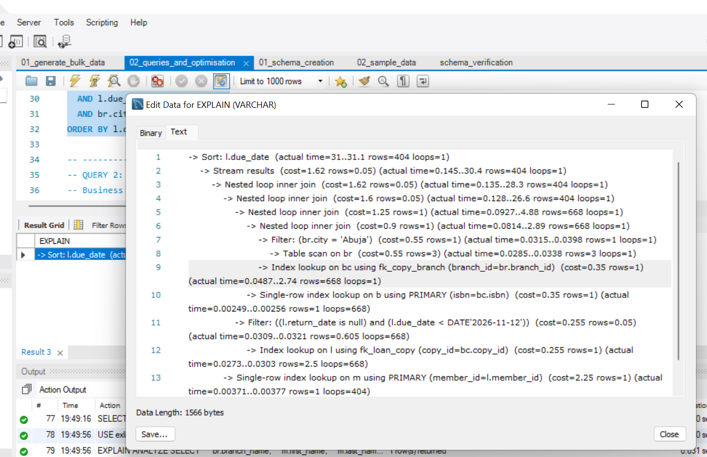
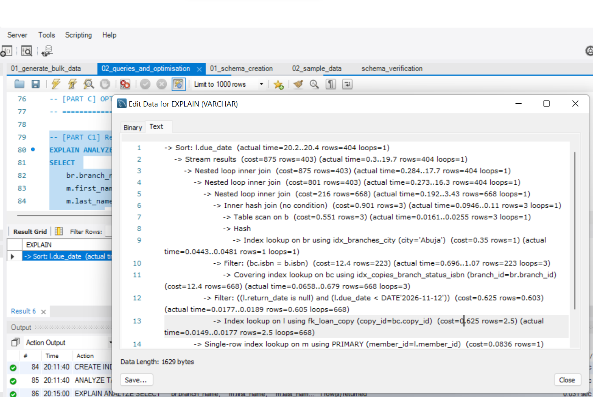
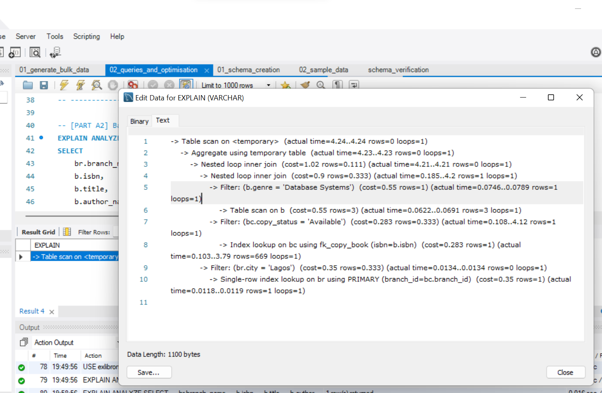
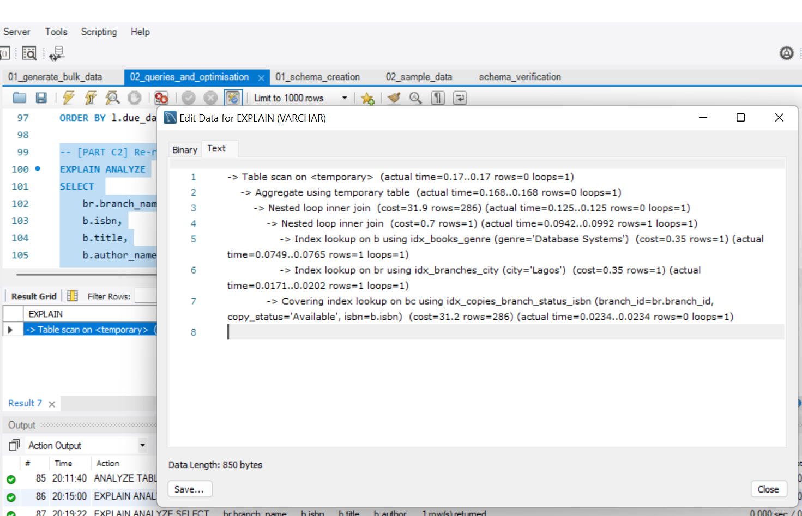

# Portfolio 2: Query Processing and Optimisation — Exlibron Library

## 1. Objective & Benchmarking Setup
To evaluate query execution plans and index performance realistically, the `exlibron_library` database was populated using Recursive Common Table Expressions (`WITH RECURSIVE`) in `01_generate_bulk_data.sql` to create:
* **1,000** synthetic library members (`1,003` total with seed data)
* **2,000** physical book copies across the Abuja, Lagos, and Port Harcourt branches (`2,004` total)
* **5,000** historical and active loan records (`5,002` total)

All execution benchmarks were conducted on **MySQL 8.0+ (InnoDB)** in MySQL Workbench using `EXPLAIN ANALYZE` before and after creating secondary B-Tree and covering indexes.

---

## 2. Query 1: Overdue Active Loans Report (Abuja Branch)

### Business Use Case
Front-desk librarians at the Abuja branch retrieve all currently unreturned, overdue books ordered by the oldest due date to issue reminder notices.

### SQL Query
```sql
SELECT 
    br.branch_name,
    m.first_name,
    m.last_name,
    m.email,
    b.title,
    l.due_date,
    DATEDIFF('2026-11-12', l.due_date) AS days_overdue
FROM loans l
JOIN book_copies bc ON l.copy_id = bc.copy_id
JOIN branches br ON bc.branch_id = br.branch_id
JOIN books b ON bc.isbn = b.isbn
JOIN members m ON l.member_id = m.member_id
WHERE l.return_date IS NULL
  AND l.due_date < '2026-11-12'
  AND br.city = 'Abuja'
ORDER BY l.due_date ASC;
```

### Execution Plan Analysis
* **Before Indexing (`31.1 ms`):**
  * MySQL performed a `Table scan on br` to locate `'Abuja'`, followed by a clustered table lookup on `book_copies` via `fk_copy_branch` (`668` rows) and `668` individual primary key lookups on `books`, before probing `loans` (`2.5` loops per copy) and running an in-memory `Sort: l.due_date`.
  * 
* **Optimisation Applied:**
  * Created indexes **`idx_branches_city (city)`**, **`idx_copies_branch_status_isbn (branch_id, copy_status, isbn)`**, and **`idx_loans_return_due (return_date, due_date)`**, followed by `ANALYZE TABLE` to update optimizer statistics.
* **After Indexing (`20.4 ms` — 34.4% Faster):**
  * MySQL used `idx_branches_city` (`city='Abuja'`) and switched to a **`Covering index lookup on bc using idx_copies_branch_status_isbn`**, while hash-joining the 3-row `books` table once instead of executing 668 repeated PK lookups.
  * 

---

## 3. Query 2: Available Book Copies by Genre and City

### Business Use Case
Library members filter the catalogue for available books within a specific genre (`Database Systems`) at a specific city branch (`Lagos`) before visiting.

### SQL Query
```sql
SELECT 
    br.branch_name,
    b.isbn,
    b.title,
    b.author_name,
    COUNT(bc.copy_id) AS available_copies
FROM book_copies bc
JOIN books b ON bc.isbn = b.isbn
JOIN branches br ON bc.branch_id = br.branch_id
WHERE b.genre = 'Database Systems'
  AND bc.copy_status = 'Available'
  AND br.city = 'Lagos'
GROUP BY br.branch_name, b.isbn, b.title, b.author_name;
```

### Execution Plan Analysis
* **Before Indexing (`4.24 ms`):**
  * MySQL executed a `Table scan on b` to filter `genre = 'Database Systems'`, then performed a non-covering index lookup on `book_copies` via `fk_copy_book`, reading **669 data rows** from disk to filter `copy_status = 'Available'` before joining `branches`.
  * 
* **Optimisation Applied:**
  * Created **`idx_books_genre (genre)`**, **`idx_branches_city (city)`**, and composite **Covering Index** **`idx_copies_branch_status_isbn (branch_id, copy_status, isbn)`**.
* **After Indexing (`0.17 ms` — 96.0% Faster):**
  * MySQL resolved `books` via `idx_books_genre` (`0.076 ms`), `branches` via `idx_branches_city` (`0.020 ms`), and executed a **3-column Covering Index lookup** on `idx_copies_branch_status_isbn (branch_id, copy_status, isbn)` in **`0.023 ms`** without touching the main `book_copies` table pages.
  * 

---

## 4. Performance Comparison Summary

| Metric | Query 1 (Before) | Query 1 (After) | Query 2 (Before) | Query 2 (After) |
| :--- | :--- | :--- | :--- | :--- |
| **Branches Access** | `Table scan on br` | `Index lookup` (`idx_branches_city`) | `PRIMARY` lookup after `bc` scan | `Index lookup` (`idx_branches_city`) |
| **Book Copies Access** | Table lookup via `fk_copy_branch` | **Covering Index lookup** (`idx_copies_branch_status_isbn`) | Table read of 669 rows via `fk_copy_book` | **Covering Index lookup** (`branch_id, copy_status, isbn`) |
| **Books Access** | 668 repeated PK lookups | Hash join (3 rows) | `Table scan on b` | `Index lookup` (`idx_books_genre`) |
| **Actual Execution Time** | **31.1 ms** | **20.4 ms (-34.4%)** | **4.24 ms** | **0.17 ms (-96.0%)** |

---

## 5. Optimizer Insights & Indexing Trade-offs

* **Covering Index Efficiency:** Query 2 achieved a **96.0% speedup** because all predicates (`branch_id`, `copy_status`, `isbn`) were contained inside the B-Tree leaf nodes of `idx_copies_branch_status_isbn`, enabling an Index-Only Scan (`Covering index lookup`) with zero table data page reads.
* **Cost-Based Join Ordering:** In Query 1, even though `idx_loans_return_due` was available, MySQL's Cost-Based Optimizer chose to drive the join from `idx_branches_city` (`city='Abuja'`) and the covering index on `book_copies`. Filtering down to a single branch first (`668` copies) was more selective than scanning all active overdue loans across all three branches.
* **Write vs. Read Trade-off:** While secondary B-Tree indexes dramatically reduce read latency for searches and reports, each index adds minor write overhead during `INSERT`/`UPDATE` transactions and consumes extra storage. Indexes were therefore limited to high-selectivity search and join columns.

---

## 6. Files Included
* **`01_generate_bulk_data.sql`**: Recursive CTE script generating 1,000 members, 2,000 physical copies, and 5,000 loan records.
* **`02_queries_and_optimisation.sql`**: Baseline queries, index creation DDL statements, `ANALYZE TABLE`, and post-index `EXPLAIN ANALYZE` queries.
* **`query1_before_index.png` & `query1_after_index.png`**: MySQL Workbench `EXPLAIN ANALYZE` evidence for Query 1.
* **`query2_before_index.png` & `query2_after_index.png`**: MySQL Workbench `EXPLAIN ANALYZE` evidence for Query 2.

---

## 7. Academic Integrity & AI Use Declaration
* **AI Tool Used:** Google Gemini
* **Purpose:** Assisted in structuring the Recursive CTE data generation script, designing composite B-Tree indexes, and interpreting MySQL 8.0 `EXPLAIN ANALYZE` execution trees.
* **Verification:** All SQL scripts were executed locally in MySQL Workbench 8.0, and all execution timings and plan details were captured directly from local test runs.

