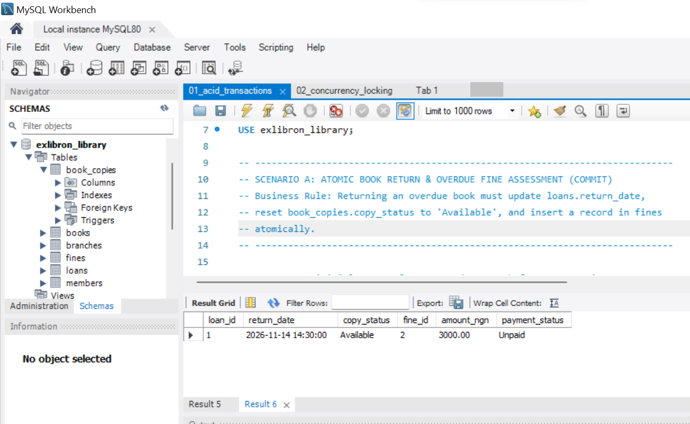
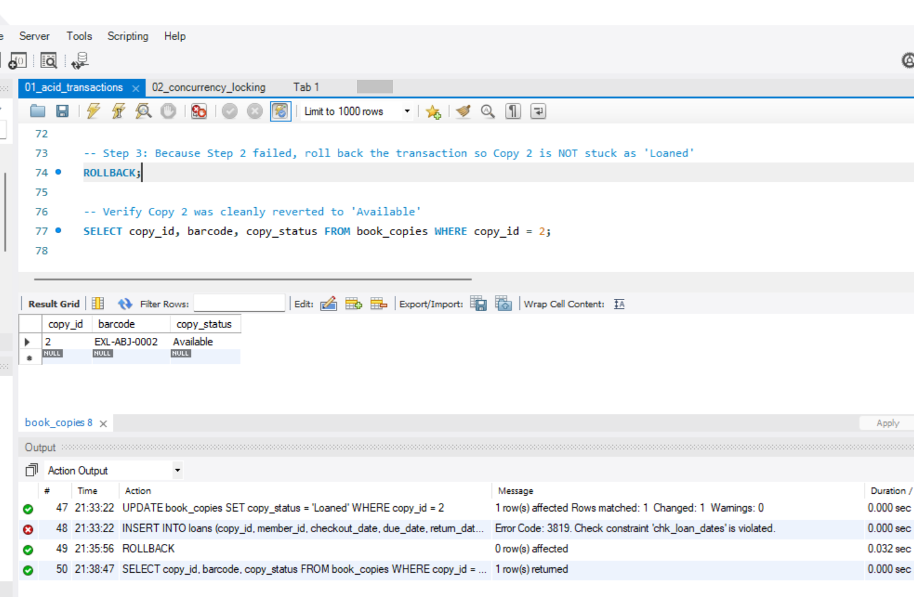
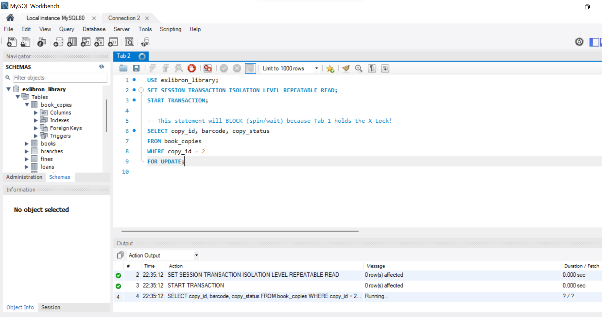

# Portfolio 3: Transactions and Concurrency Control — Exlibron Library

## 1. Overview
In a multi-branch library system like **Exlibron Library**, multiple librarians and online users concurrently check out books, process returns, and assess fines. Without proper transaction management and concurrency control, partial failures can leave inventory statuses out of sync, and race conditions can allow two members to borrow the exact same physical copy simultaneously.

This portfolio demonstrates **ACID transaction guarantees** (`COMMIT` and `ROLLBACK`) and **pessimistic row-level locking (`SELECT ... FOR UPDATE`)** under MySQL InnoDB's default **`REPEATABLE READ`** isolation level.

---

## 2. ACID Transaction Demonstrations (`01_acid_transactions.sql`)

### Scenario A: Atomic Book Return & Overdue Fine Assessment (`COMMIT`)
* **Business Process:** When a member returns an overdue book (`loan_id = 1`), three operations must succeed together as a single atomic unit:
  1. Update `loans.return_date` with the return timestamp.
  2. Update `book_copies.copy_status` back to `'Available'`.
  3. Insert an `'Unpaid'` fine record (`₦3,000.00`) into `fines`.
* **Result:** Executing `COMMIT` persisted all three updates permanently, guaranteeing **Atomicity** and **Consistency** across `loans`, `book_copies`, and `fines`.
* 

### Scenario B: Constraint Violation & Transaction Recovery (`ROLLBACK`)
* **Business Process:** During a book checkout (`copy_id = 2`), the copy status is updated to `'Loaned'`, followed by inserting a new row into `loans`. An invalid `return_date` earlier than `checkout_date` triggers MySQL `Error 3819` (`chk_loan_dates` check constraint violation).
* **Result:** Issuing `ROLLBACK` undid the preliminary `UPDATE` on `book_copies`, restoring `copy_id = 2` to `'Available'` so inventory never becomes orphaned in a `'Loaned'` state.
* 

---

## 3. Concurrency Control & Locking (`02_concurrency_locking.sql`)

### Concurrency Problem Addressed: Lost Update / Double-Booking Race Condition
* If Librarian A (Session 1) and Librarian B (Session 2) both read `copy_status = 'Available'` for `copy_id = 2` at the same millisecond using plain `SELECT` statements, both sessions could attempt to lend out the same physical book.

### Control Mechanism: Pessimistic Locking (`SELECT ... FOR UPDATE`)
* Both sessions operate at **`REPEATABLE READ`** isolation and execute `SELECT copy_id, barcode, copy_status FROM book_copies WHERE copy_id = 2 FOR UPDATE;` inside an explicit transaction.
* **Execution Flow:**
  1. **Session 1 (Librarian A)** acquires an **Exclusive Row Lock (X-Lock)** on `copy_id = 2`.
  2. **Session 2 (Librarian B)** attempts the same `SELECT ... FOR UPDATE` and is automatically blocked by InnoDB's lock manager until Session 1 finishes.
  3. **Session 1** updates `copy_status = 'Loaned'`, inserts the loan record, and runs `COMMIT`, releasing the lock.
  4. **Session 2** immediately unblocks, reads the newly committed state (`copy_status = 'Loaned'`), and safely executes `ROLLBACK` instead of creating a duplicate loan.
* 

---

## 4. Isolation Level Trade-offs in Exlibron Library
* **`READ COMMITTED` vs. `REPEATABLE READ`:** MySQL InnoDB defaults to `REPEATABLE READ`, which uses Multi-Version Concurrency Control (MVCC) snapshots to prevent **Dirty Reads** and **Non-Repeatable Reads** during reporting queries while using next-key/row locks (`FOR UPDATE`) to serialize conflicting writes.
* **Locking Trade-off:** Pessimistic locking (`FOR UPDATE`) adds brief wait latency when two librarians access the exact same copy barcode simultaneously, which is an ideal trade-off because physical copy collisions are rare and data accuracy is mandatory.

---

## 5. Files Included
* **`01_acid_transactions.sql`**: Demonstrates multi-table `COMMIT` and constraint-triggered `ROLLBACK`.
* **`02_concurrency_locking.sql`**: Two-session concurrent checkout script using `SELECT ... FOR UPDATE`.
* **`acid_commit_evidence.png`**, **`acid_rollback_evidence.png`**, **`concurrency_lock_evidence.png`**: MySQL Workbench execution screenshots.

---

## 6. Academic Integrity & AI Use Declaration
* **AI Tool Used:** Google Gemini
* **Purpose:** Assisted in structuring multi-table transaction test cases and designing the two-session `SELECT ... FOR UPDATE` concurrency scenario.
* **Verification:** Executed both transaction scripts and simulated two concurrent sessions locally in MySQL Workbench 8.0, capturing and verifying all outputs independently.

