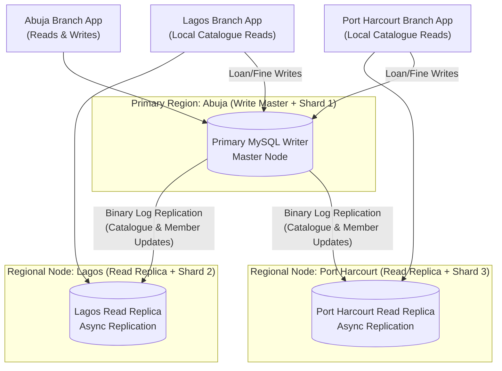
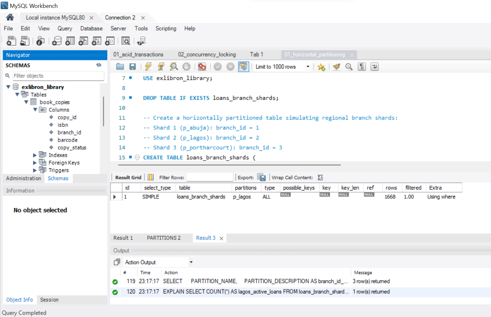

# Portfolio 5: Distributed and Cloud Database Exercise — Exlibron Library

## 1. Multi-Branch Cloud Database Architecture
As **Exlibron Library** expands across **Abuja**, **Lagos**, and **Port Harcourt**, a single centralized database server introduces high cross-region network latency and a single point of failure. To achieve high availability and low-latency local catalogue searches, the system is architected for a **Managed Cloud Database deployment (e.g., AWS RDS for MySQL / Amazon Aurora or PlanetScale/Vitess)** combining **Read Replicas** and **Horizontal Sharding**.

---

## 2. Replication Strategy (High Availability & Read Scaling)
* **Topology:** **Single-Primary (Master) with Multi-Region Read Replicas**.
* **How It Works:**
  * Global reference tables (`books`, `branches`, `members`) and transactional writes (`loans`, `fines`) are committed to the **Primary Writer Node** in Abuja (with a synchronous **Multi-AZ Standby Replica** for automatic failover within 30 seconds).
  * **Asynchronous Binary Log (Binlog) Replication** streams updates to regional **Read Replicas** in Lagos and Port Harcourt.
* **Benefit:** Over 85% of library traffic consists of read-heavy catalogue searches (`SELECT` queries). Serving reads from local regional replicas eliminates cross-city round-trip latency while offloading read traffic from the primary writer.

---

## 3. Sharding & Horizontal Partitioning Strategy (`01_horizontal_partitioning.sql`)
* **Shard Key Selection:** **`branch_id`** (`1 = Abuja`, `2 = Lagos`, `3 = Port Harcourt`).
* **Why `branch_id` Fits Best:** Physical book copies (`book_copies`) and circulation logs (`loans`) exhibit strong **geographic data locality**—members almost always borrow and return physical books at their local city branch.
* **Avoiding Cross-Shard Joins:** Because `book_copies` and `loans` are co-located using `branch_id`, daily branch circulation queries execute locally on a single shard without expensive distributed cross-shard joins.
* **Practical Verification (Partition Pruning):**
  * Using MySQL `PARTITION BY LIST (branch_id)`, the 5,002 loan records were evenly partitioned across `p_abuja`, `p_lagos`, and `p_portharcourt`.
  * Running `EXPLAIN` for a Lagos query (`WHERE branch_id = 2`) confirmed **Partition Pruning** (`partitions: p_lagos`), proving the query engine skips the Abuja and Port Harcourt partitions entirely.
  * 

---

## 4. Availability, Consistency & CAP Theorem Trade-offs

Under the **CAP Theorem**, during a network partition (**P**) between branch locations, a distributed database must balance **Consistency (C)** against **Availability (A)**:

| Workload Type | CAP Priority | Consistency Model | Architectural Justification |
| :--- | :--- | :--- | :--- |
| **Book Check-outs, Returns & Fines** | **CP (Strong Consistency)** | Synchronous writes to Primary Master (`REPEATABLE READ`) | Prevents double-lending the same physical copy or losing fine payments during network instability. |
| **Public Catalogue & Availability Search** | **AP (Eventual Consistency)** | Asynchronous Read Replicas (sub-second replication lag) | Members can continue browsing the catalogue and checking general availability in Lagos/Port Harcourt even if the link to Abuja experiences brief latency. |

### Backup, Failover & Security Controls
* **Automated Backups:** Continuous Point-in-Time Recovery (PITR) using automated daily snapshots + archived binary logs stored in geo-redundant object storage.
* **Encryption:** TLS 1.3 encryption in transit for all cross-branch database traffic and AES-256 encryption at rest for stored member and financial records.

---

## 5. Files Included
* **`01_horizontal_partitioning.sql`**: MySQL `LIST` partitioning implementation simulating branch-level sharding and `EXPLAIN` partition pruning.
* **`partition_evidence.png`**: MySQL Workbench output verifying row distribution across branch partitions and single-partition query routing.

---

## 6. Academic Integrity & AI Use Declaration
* **AI Tool Used:** Google Gemini
* **Purpose:** Assisted in designing the multi-branch cloud replication topology, evaluating CAP theorem trade-offs, and writing the MySQL `LIST` partitioning verification script.
* **Verification:** Executed `01_horizontal_partitioning.sql` locally in MySQL Workbench 8.0, verified partition row counts and `EXPLAIN` pruning outputs, and captured screenshot evidence independently.

